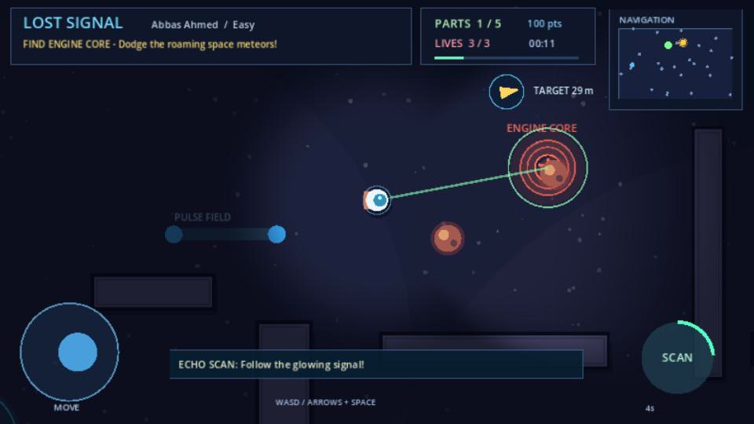

<h1 align="center">Lost Signal: Escape Pluto</h1>
<p align="center"><strong>A transmission cuts out in Pakistan. Three astronauts go looking for its source.</strong><br>
A landscape Android adventure by bunyan al marsoos.</p>
<p align="center">
  <a href="https://github.com/aazannoorkhuwaja/lost-signal-escape-pluto/releases/tag/pluto-crew"></a>
  
  
</p>
<p align="center">
  <a href="https://github.com/aazannoorkhuwaja/lost-signal-escape-pluto/releases/download/pluto-crew/LostSignal.apk">Download for Android</a> ·
  <a href="https://github.com/aazannoorkhuwaja/lost-signal-escape-pluto/releases/download/pluto-crew/LostSignal-demo.mp4">Watch the gameplay demo</a>
</p>

## 📡 The last transmission

In this fictional mission, the night shift at SUPARCO Mission Control in Pakistan is listening to a weather report from Pluto Station when the transmission cuts off. Abbas Ahmed, Aazan Noor Khuwaja and Mushaf ALi Mir launch for Pluto. Without the station’s landing beacon, the crew spots an ice ridge too late. The hull splits, and the first five components skid out of sight.

Abbas has a torch somewhere east of the wreck. That’s all the crew has to navigate by until he finds it.



## 🧑‍🚀 Meet the crew

The three members of **bunyan al marsoos** appear as the astronauts you play, one per level.

| Flight | Astronaut | Recovery |
| --- | --- | --- |
| Easy | **Abbas Ahmed** | Find the torch, recover the first five parts and get the craft off the ice. |
| Medium | **Aazan Noor Khuwaja** | Recover six parts, including the coolant pump. Three fractured ice patches cut across the route. |
| Hard | **Mushaf ALi Mir** | Bring back all seven parts, including the flight recorder. Six fractures guard the route home to Pakistan. |

## 📱 Install and play

1. Download **LostSignal.apk** from the release linked above. Open it on an ARM Android phone running Android 7.0 or later.
2. Hold the phone in landscape. Tap to begin Abbas’s flight. Move east to pick up the torch and bring the map online.
3. Follow **gold** to the next component. **Green** marks your astronaut and **blue** marks the ship. Tap **SCAN** for a bearing. It recharges in five seconds. Return to the ship after the final pickup.

| Action | Android | Desktop |
| --- | --- | --- |
| Move | Drag the left thumbstick | WASD or arrow keys |
| Scan | Tap SCAN with your right thumb | Space |
| Advance after launch | Tap Next | Enter |
| Retry the current flight | Tap Replay level or Retry level | R |

Each recovery saves a checkpoint. A part earns 100 points for Abbas, 200 for Aazan and 300 for Mushaf. Launch adds 100 points per remaining life and up to 300 for speed. Advancing banks the score. A retry resets only the current flight’s points.

## 🛠 Run from source

Open [game/project.godot](game/project.godot) in Godot 4.7.2 and press **F5**. Press **Enter** to start or skip the opening. The Android export preset is included. To run the [campaign regression test](tests/flight_check.gd) from the repository root:

```sh
godot --headless --path game --import
godot --headless --path game --script "$PWD/tests/flight_check.gd"
```

## Credits

Built for the **LOST** theme at Coder’s Cup ’26. The terrain, spacecraft and lighting are drawn in Godot. Sound effects are synthesized, and text uses Godot’s bundled font. ChatGPT and Codex assisted with design, code, interface, sound generation, testing, Android packaging and documentation.
